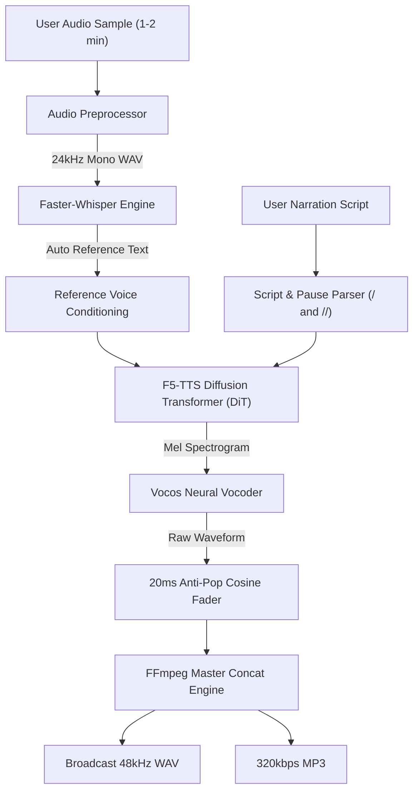

# 🎙️ VoiceClone Studio

> **Instant Zero-Shot Neural Voice Cloning & Long-Form Narration Studio**  
> Clone your voice from a 1–2 minute sample and generate broadcast-quality narration with natural pacing, customizable pauses, and zero fine-tuning.

[](https://www.python.org/)
[](https://pytorch.org/)
[](https://github.com/SWivid/F5-TTS)
[]()
[](LICENSE)

---

## ✨ Features

- ⚡ **Zero-Shot Voice Cloning**: Clone your voice with just **15 seconds to 2 minutes** of clean speaking audio. No multi-hour dataset training or weight fine-tuning required.
- 🎯 **Natural Lecture Pacing (145 WPM)**: Automatically compensates for slow reading styles using calibrated flow duration scaling (`speed = 1.40`), avoiding sluggish, drawn-out syllables.
- ⏸️ **Exact Pause Control**: Mark 1-beat pauses (`/`) and 2-beat pauses (`//`) directly in your script for precise equation, chart, and slide sync.
- 🛡️ **Zero Click / Anti-Pop Boundaries**: Applies 20ms cosine micro-fades at every pause boundary to eliminate DC offset clicks and abrupt vocoder pops.
- 🤖 **Auto-Transcription via Whisper**: Drop in any voice recording; local **Faster-Whisper** extracts the spoken reference text in under 1 second.
- 🍏 **Apple Silicon Native**: Full hardware acceleration on **Apple M-Series GPUs** (`mps`), as well as NVIDIA CUDA and CPU fallbacks.
- 📻 **Broadcast 48 kHz Export**: Direct downloads for lossless **48 kHz 16-bit Mono WAV** and streaming-ready **320 kbps MP3**.

---

## 🏗️ System Architecture



---

## 🚀 Quickstart Guide

### 1. Prerequisites
- Python 3.10+ (tested on macOS Sonoma/Sequoia & Linux Ubuntu)
- `ffmpeg` installed on your system:
  ```bash
  # macOS (Homebrew)
  brew install ffmpeg

  # Linux (Ubuntu/Debian)
  sudo apt update && sudo apt install -y ffmpeg
  ```

### 2. Clone & Setup
```bash
# Clone the repository
git clone https://github.com/dnyanshwalwadka/voice-clone-studio.git
cd voice-clone-studio

# Run the automated launch script
chmod +x start.sh
./start.sh
```

Or setup manually:
```bash
python3 -m venv venv
source venv/bin/activate
pip install -r requirements.txt
python3 app.py
```

### 3. Open Web Studio
Navigate to:
```
http://127.0.0.1:7860
```

---

## 🖥️ Web UI Walkthrough

1. **Step 1: Vocal Profile**
   - Drag & drop your voice recording (`.wav`, `.mp3`, `.m4a`, etc.) or click **Record Live via Microphone**.
   - The engine automatically resamples the audio and transcribes the speech in real-time.
2. **Step 2: Script & Pause Delivery**
   - Type or paste your narration script.
   - Click `+ 1-Beat Pause (/)` or `+ 2-Beat Pause (//)` where you want the narration to pause for slide cuts or visual transitions.
3. **Step 3: Speaking Tempo**
   - Adjust the **Speaking Speed** slider (`1.00×` to `1.60×`). Recommended: **`1.40×`** for crisp, confident lecture flow (~145 WPM).
4. **Step 4: Clone & Download**
   - Click **Clone Voice & Synthesize Audio**.
   - Monitor real-time synthesis progress.
   - Preview the narration directly in the browser and download the **48 kHz WAV** or **320 kbps MP3**.

---

## 🔌 REST API Documentation

The backend exposes a fully functional REST API:

### `POST /api/upload_voice`
Uploads reference audio and returns voice ID and Whisper transcription.
* **Form-data**: `file: [audio binary]`
* **Response**:
  ```json
  {
    "voice_id": "a1b2c3d4",
    "filename": "my_voice.wav",
    "transcript": "Every large language model has the same quiet limitation.",
    "audio_url": "/api/audio/upload/a1b2c3d4_clean.wav"
  }
  ```

### `POST /api/generate`
Queues a neural voice cloning generation job.
* **JSON Body**:
  ```json
  {
    "voice_id": "a1b2c3d4",
    "ref_text": "Spoken text from reference clip...",
    "script_text": "Welcome to the video. / Here is the core architecture.",
    "speed": 1.40
  }
  ```
* **Response**:
  ```json
  {
    "job_id": "e5f6g7h8",
    "status": "queued"
  }
  ```

### `GET /api/progress/{job_id}`
Returns the live progress percentage and status message.

### `GET /api/download/{job_id}/{format}`
Downloads the synthesized master audio file (`wav` or `mp3`).

---

## ⚡ Performance & Benchmarks

Benchmarked on **Apple M4 Pro (24 GB RAM, MPS Device)**:
- **Model Load Time**: ~1.5s
- **Inference Speed**: ~6–7 seconds per sentence chunk
- **Peak VRAM / Unified Memory**: ~3.2 GB
- **Audio Output**: 48,000 Hz, 16-bit Mono PCM, 768 kbps bitrate

---

## 📦 Pushing to Your GitHub Repository

To push this repository to your personal GitHub account:

```bash
cd voice_clone_studio

# Initialize Git
git init
git add .
git commit -m "feat: initial commit of VoiceClone Studio with F5-TTS, Faster-Whisper, and modern Web UI"

# Add your GitHub remote
git remote add origin https://github.com/dnyanshwalwadka/voice-clone-studio.git

# Set main branch and push
git branch -M main
git push -u origin main
```

*(Ensure you have created the empty repository `voice-clone-studio` on your GitHub account at `https://github.com/dnyanshwalwadka/voice-clone-studio`).*

---

## 📄 License

This project is licensed under the [MIT License](LICENSE) - see the LICENSE file for details.

---

## 👤 Author

Developed by **[Dnyanesh Walwadkar](https://github.com/dnyanshwalwadka)**  
Contributions and stars are welcome! ⭐️
